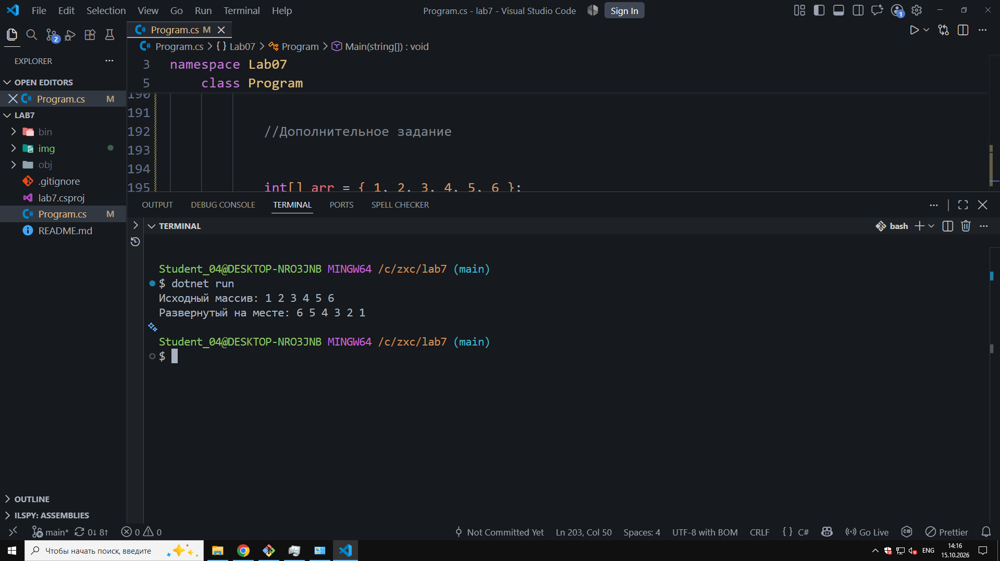
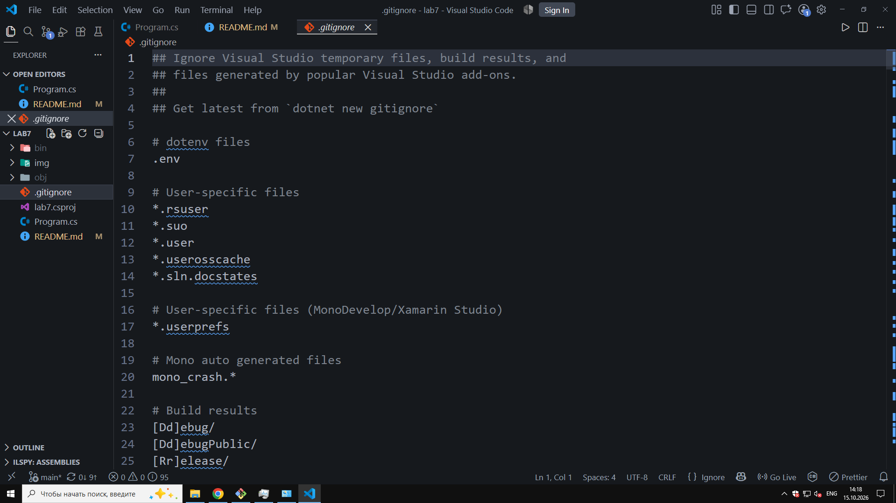

# Lab №7

**ФИО:** Чумаченко Михаил
**Группа:** ИСП-242
**Дата:** 15.10.2026

## Что изучено

- Нумерация (индексация) элементов массива всегда начинается строго с 0, а индекс последнего элемента равен длине массива минус единица (Length - 1).
- Цикл `foreach` используется исключительно для последовательного чтения данных из массива; изменять элементы внутри него нельзя.
- Для изменения содержимого ячеек массива или работы с индексами (например, для вывода элементов в обратном порядке) необходимо использовать классический цикл `for`.

## Скриншоты

